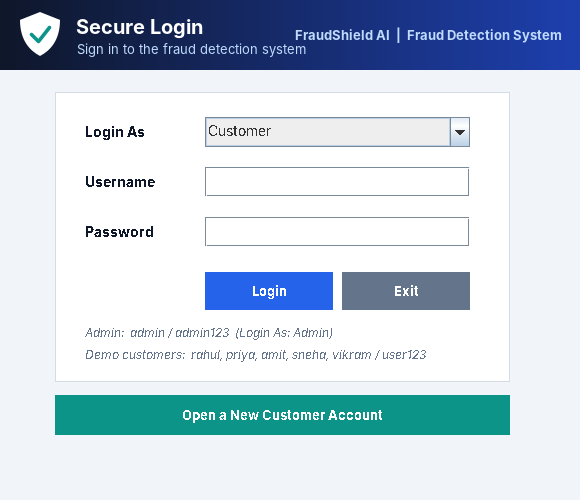
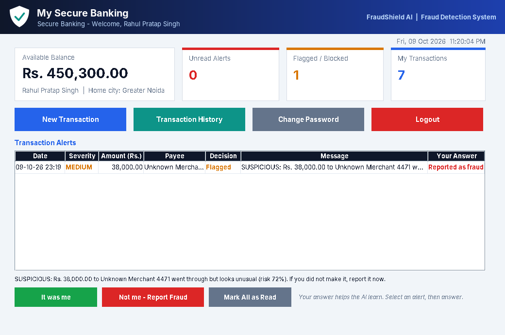
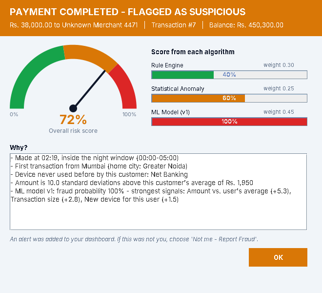
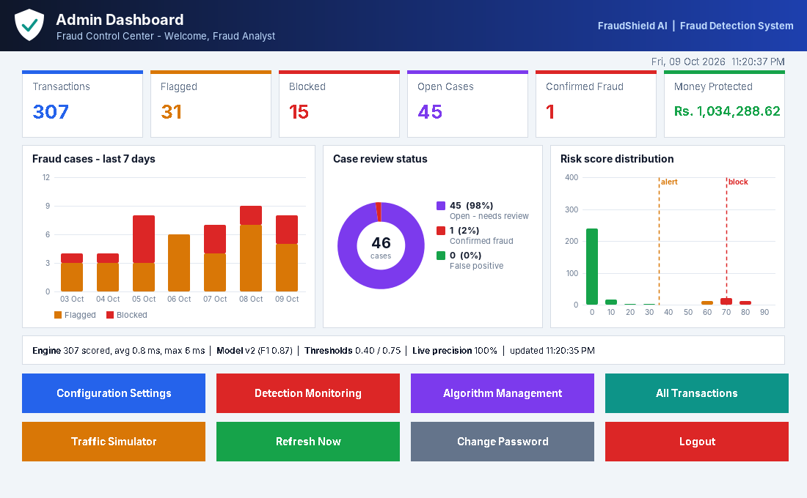
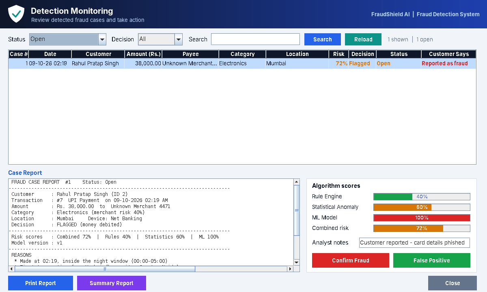
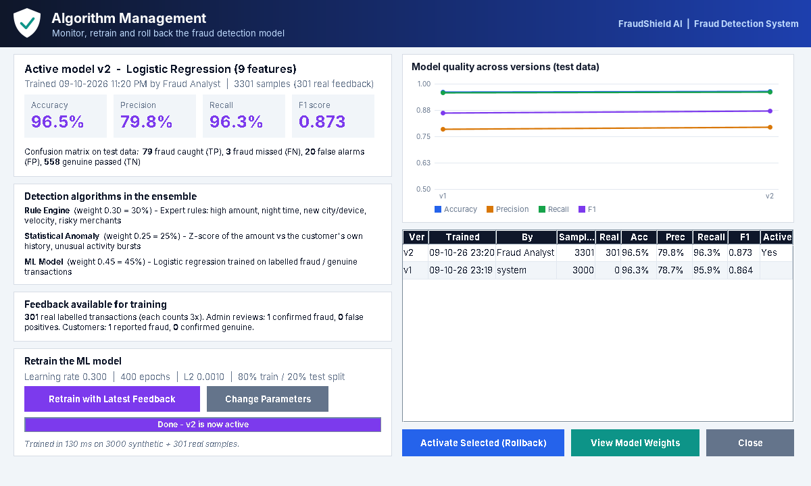
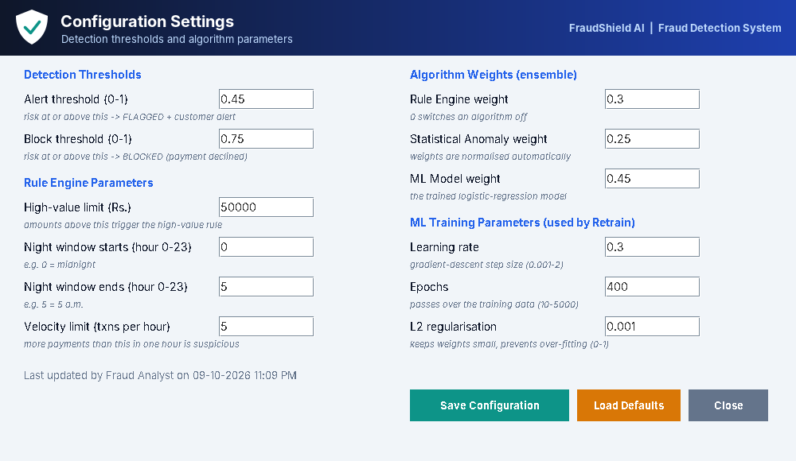
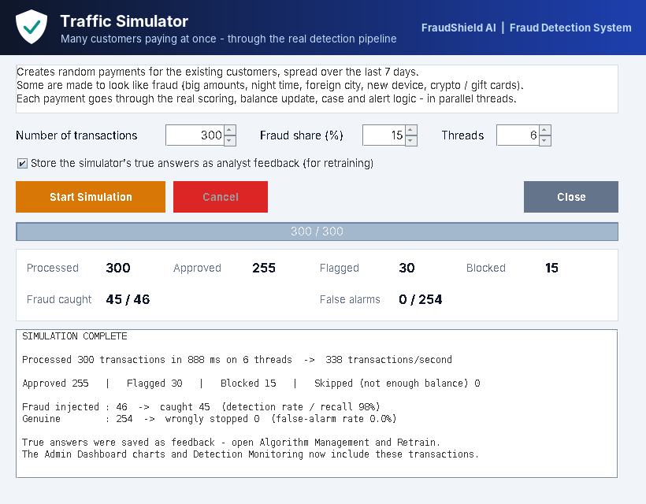

# 🛡️ AI-Powered Fraud Detection System (FraudShield AI)

A Java desktop application that checks every financial transaction for fraud **in real time**
using three detection algorithms — expert **rules**, **statistical anomaly detection** and a
**machine-learning model** (logistic regression written in plain Java) — combined into one
weighted risk score. Suspicious payments are **flagged** or **blocked**, customers receive
**alerts**, the admin reviews cases, and the model is **retrained from that feedback**.

Built with **Java Swing**, **MySQL** and **JDBC** as a NetBeans (Ant) project.
No external libraries except the MySQL JDBC driver — the ML model and all charts are written from scratch.

---

## 📋 Table of Contents
- [Requirement Coverage](#-requirement-coverage)
- [How Fraud Detection Works](#-how-fraud-detection-works)
- [Screenshots](#-screenshots)
- [Tech Stack](#-tech-stack)
- [Architecture](#-architecture)
- [Project Structure](#-project-structure)
- [Java Concepts Implemented (Rubric Mapping)](#-java-concepts-implemented-rubric-mapping)
- [Requirements](#-requirements)
- [Setup Guide](#-setup-guide)
- [How to Run](#-how-to-run)
- [Default Logins](#-default-logins)
- [Demo Flow](#-demo-flow)
- [Database Schema](#-database-schema)
- [Troubleshooting](#-troubleshooting)
- [Known Limitations](#-known-limitations)

---

## ✅ Requirement Coverage

| Requirement (project brief) | Where in the app |
|---|---|
| **Admin – System Configuration** (input: thresholds, algorithm parameters → output: confirmation) | *Configuration Settings*: alert/block thresholds, high-value limit, night window, velocity limit, algorithm weights, learning rate, epochs, L2. Validated, saved, confirmation pop-up, applied to the next transaction immediately |
| **Admin – Detection Monitoring** (input: detected cases → output: detailed reports) | *Detection Monitoring*: filter/search all cases, full printable case report (transaction, per-algorithm scores, reasons, customer's answer), *Confirm Fraud* / *False Positive*, summary report |
| **Admin – Algorithm Updates** (input: performance data + feedback → output: updated algorithm) | *Algorithm Management*: accuracy / precision / recall / F1 + confusion matrix, feedback counts, **Retrain with Latest Feedback** (live progress), version history, roll back, view learned weights |
| **User – Transaction Monitoring** (input: transaction details → output: alerts) | *New Transaction* → scored in real time → result screen with risk gauge and reasons; FLAGGED/BLOCKED payments create alerts |
| **Admin Dashboard** – configuration form, graphical detection reports, algorithm management | Stat cards, **bar chart** (cases per day), **donut chart** (case status), **histogram** (risk distribution with threshold lines), live engine performance, buttons to each section |
| **User Dashboard** – list of alerts for suspicious transactions | *Transaction Alerts* table with *It was me* / *Not me – Report Fraud*, polled automatically every 10 s |
| Monitoring system performance | Live engine counters (transactions scored, average / max scoring time), live precision, model metrics, Traffic Simulator throughput and detection rate |

---

## 🧠 How Fraud Detection Works

**1. Features** — every transaction is turned into 9 numbers (`FeatureExtractor`):

| # | Feature | Meaning |
|---|---|---|
| 0 | Amount z-score | how unusual the amount is **for this customer** |
| 1 | Transaction size | ln(1 + amount) |
| 2 | Share of balance | amount ÷ balance |
| 3 | Night time | inside the configured night window |
| 4 | New city | never used by this customer before |
| 5 | New device | never used by this customer before |
| 6 | Velocity | the customer's transactions in the last hour |
| 7 | Merchant risk | 0.05 (grocery) … 0.9 (crypto, gambling) |
| 8 | International | foreign location |

**2. Three algorithms** (each implements `FraudDetector`):

| Algorithm | How it scores (0 – 1) |
|---|---|
| **Rule Engine** | Adds points for rules that fire: high amount, ≥80 % of balance, night, new/foreign city, new device, velocity, risky merchant |
| **Statistical Anomaly** | z-score of the amount vs the customer's own average and spread, activity bursts, balance drain |
| **ML Model** | Logistic regression `p = 1 / (1 + e^-(b + Σ wᵢxᵢ))` trained by gradient descent; explains itself by listing the features that raised the probability most |

**3. Ensemble** — weighted average (weights from Configuration) → **risk score**.

**4. Decision** — `risk ≥ block threshold` → **BLOCKED** (not debited); `≥ alert threshold` → **FLAGGED**
(debited, alert + case); otherwise **APPROVED**.

**5. Learning loop** — the admin's case decisions and customers' answers become **labels**.
*Retrain* combines 3,000 synthetic examples with all real labelled transactions (real ones count 3×),
holds 20 % back as a test set, trains a new version, measures it and makes it active. Older versions
can be re-activated at any time.

---

## 📸 Screenshots

| Login | Customer Dashboard (alerts) |
|---|---|
|  |  |

| Transaction result (risk gauge + reasons) | Admin Dashboard (charts) |
|---|---|
|  |  |

| Detection Monitoring | Algorithm Management |
|---|---|
|  |  |

| Configuration Settings | Traffic Simulator |
|---|---|
|  |  |

---

## 🛠 Tech Stack

| Layer | Technology |
|---|---|
| Language | Java 17 |
| GUI | Java Swing / AWT; charts, gauge, logo and header drawn with Java2D |
| Machine learning | Own logistic-regression implementation with parallel gradient descent |
| Database | MySQL 8.0 |
| Connectivity | JDBC + MySQL Connector/J |
| IDE / Build | Apache NetBeans + Apache Ant |

---

## 🏗 Architecture

```
┌──────────────────────────────────────────────────────────┐
│ UI (ui, ui.chart)  Swing screens, Java2D charts           │
└───────────────────────────┬──────────────────────────────┘
                            │
┌───────────────────────────▼──────────────────────────────┐
│ Services (service)                                        │
│ TransactionService, CaseService, ModelTrainingService,    │
│ SimulationService, ConfigManager (ReadWriteLock)          │
└───────┬───────────────────────────────────┬──────────────┘
        │                                   │
┌───────▼─────────────────────┐   ┌─────────▼──────────────┐
│ Detection engine (engine)   │   │ DAO layer (dao)        │
│ Rule / Statistical / ML     │   │ GenericDAO<T,K> + one  │
│ detectors -> Ensemble       │   │ class per table        │
│ ML core (ml): logistic      │   └─────────┬──────────────┘
│ regression, metrics         │             │ JDBC
└─────────────────────────────┘   ┌─────────▼──────────────┐
                                  │ DBConnection Singleton │
                                  │ -> MySQL               │
                                  └────────────────────────┘
```

---

## 📁 Project Structure

```
Fraud-Detection-System/
├── fraud_detection_schema.sql    database, tables, settings, admin + 5 demo customers, MySQL user
├── README.md, screenshots/, .gitignore
├── build.xml, manifest.mf, nbproject/
└── src/
    ├── db.properties
    └── fraud/detection/
        ├── Main.java
        ├── model/      Person (abstract), Admin, Customer, Transaction, TransactionRequest, FraudCase,
        │               Alert, DetectionConfig (immutable + Builder), DashboardStats, FeedbackSummary,
        │               Cities, enums: Role, TransactionType, MerchantCategory, DeviceType, Decision,
        │               CaseStatus, AlertSeverity, UserResponse
        ├── engine/     FraudDetector (interface), AbstractDetector (template method), RuleBasedDetector,
        │               StatisticalDetector, MachineLearningDetector, EnsembleDetector (composite),
        │               DetectionResult, EnsembleResult, UserProfile, FeatureExtractor,
        │               TransactionContext, Assessment, FraudDetectionEngine, PerformanceMonitor
        ├── ml/         LogisticRegressionModel, Trainable<S> (generic interface), ProbabilisticClassifier,
        │               TrainingListener, TrainingParams, LabeledSample, ModelMetrics, ModelVersion,
        │               ModelRegistry (AtomicReference), SyntheticDataGenerator, Features
        ├── exception/  FraudSystemException + 8 custom exceptions
        ├── db/         DBConnection (Singleton)
        ├── dao/        GenericDAO<T,K>, UserDAO, TransactionDAO, FraudCaseDAO, AlertDAO, ConfigDAO,
        │               ModelVersionDAO, ReportDAO
        ├── service/    TransactionService, CaseService, ModelTrainingService, SimulationService,
        │               ConfigManager, TxRunner, TransactionWork<T>, AccountLockManager,
        │               SimulationProgress, TransactionResult, TrainingOutcome
        ├── util/       BackgroundTask (SwingWorker), TableModelBuilder, PasswordUtil, Validator,
        │               MessageUtil, MoneyUtil, DateUtil
        └── ui/         BaseFrame (abstract), LoginFrame, RegisterFrame, CustomerDashboard,
                        NewTransactionFrame, TransactionResultDialog, TransactionHistoryFrame
                        -> AllTransactionsFrame, AdminDashboard, ConfigurationFrame,
                        DetectionMonitoringFrame, AlgorithmManagementFrame, TrafficSimulatorFrame,
                        ChangePasswordFrame, SplashWindow, HeaderPanel, Logo, RiskMeter, ClockLabel,
                        StatusCellRenderer, RiskValue, UITheme
            └── chart/  ChartPanel<T> (abstract, generic), BarChartPanel -> HistogramPanel,
                        DonutChartPanel, LineChartPanel, CategoryData, ChartSeries, ChartSlice
```

---

## 🎯 Java Concepts Implemented (Rubric Mapping)

### 1. OOP — Polymorphism, Inheritance, Exception Handling, Interfaces (10)

| Concept | Where | What it shows |
|---|---|---|
| **Inheritance** | `Person` → `Admin`, `Customer` | shared identity, overridden `getRole()` / `getWelcomeMessage()` |
| | `AbstractDetector` → `RuleBasedDetector`, `StatisticalDetector`, `MachineLearningDetector` | template method `evaluate()` → `computeScore()` |
| | `DetectionResult` → `EnsembleResult` | child result usable wherever the parent is expected |
| | `ChartPanel<T>` → `BarChartPanel` → `HistogramPanel` | 3-level hierarchy; histogram overrides only `barColor()` and `drawOverlay()` |
| | `BaseFrame` → every screen; `TransactionHistoryFrame` → `AllTransactionsFrame` | reuse by overriding only `fetch()` |
| | `FraudSystemException` → 8 child exceptions | exception hierarchy |
| **Runtime polymorphism** | `FraudDetectionEngine` holds `Map<FraudDetector, Double>` | calls `evaluate()` without knowing which algorithm it is |
| | `EnsembleDetector implements FraudDetector` | **composite**: a group of detectors looks like one detector |
| | `UserDAO.authenticate()` returns `Person` | Admin or Customer dashboard opens |
| | `AlgorithmManagementFrame` | each detector describes itself via `getDescription()` |
| **Interfaces** | `FraudDetector`, `ProbabilisticClassifier` (default method `predict()`), `Trainable<S>`, `TrainingListener`, `TransactionWork<T>` (functional), `GenericDAO<T,K>` (default `count()`/`update()`), `Comparable<RiskValue>` | own and Java interfaces |
| **Abstraction** | `Person`, `AbstractDetector`, `BaseFrame`, `ChartPanel<T>` | abstract classes and methods |
| **Exception handling** | `exception/` | `InsufficientBalanceException` (stores amounts), `InvalidConfigurationException`, `CaseAlreadyReviewedException`, `ModelTrainingException`, `AuthenticationException`, `UnauthorizedActionException`, `InvalidInputException`, `DatabaseException` |
| | DAOs, `TxRunner`, services | try-with-resources, try-catch-finally, rollback in `catch`, multi-catch, re-throw, `throws` |
| **Encapsulation / immutability** | `DetectionConfig`, `Transaction`, `TransactionRequest`, `UserProfile` | final fields, defensive copies |
| **Design patterns** | Builder (`DetectionConfig`), Singleton (`DBConnection`), Template Method, Composite, Strategy (detectors), Observer (`TrainingListener`) | |

### 2. Collections & Generics (6)

| Concept | Where |
|---|---|
| `List` / `ArrayList` | all query results, training data |
| `Set` / `HashSet` / `EnumSet` | known cities / known devices (`UserProfile`) |
| `Map` / `LinkedHashMap` | ensemble detectors and their weights, component results |
| `TreeMap` | dashboard cases per day (sorted dates), summary by category |
| `EnumMap` | cases by status, cases by category, totals by decision |
| `ConcurrentHashMap` | per-customer locks (`AccountLockManager`) |
| `Optional<T>` | every `findById()` |
| Streams + `Collectors.groupingBy` | table filters, summary report |
| Immutable `List.of()` / `Collections.unmodifiable…` | cities, feature names, results |
| **Generic classes / interfaces** | `ChartPanel<T>`, `GenericDAO<T,K>`, `Trainable<S>`, `TransactionWork<T>` |
| **Generic methods** | `TxRunner.<T>inTransaction()`, `TableModelBuilder.<T>build()`, `BackgroundTask.<T>run()`, `BaseFrame.<T extends JComponent>place()` |
| Generic Swing | `JComboBox<Role>`, `JComboBox<MerchantCategory>`, `SwingWorker<T,Void>` |

### 3. Multithreading & Synchronization (4)

| Concept | Where |
|---|---|
| **Parallel model training** — `ExecutorService`, `Callable`, `Future`, `invokeAll` | `LogisticRegressionModel.train()` (gradient computed in chunks on several threads) |
| **Parallel detectors** — `CompletableFuture.supplyAsync` + `join` | `EnsembleDetector` |
| **Concurrent traffic** — thread pool + `ThreadLocalRandom` + `AtomicInteger` | `SimulationService`, `SimulationProgress` |
| `ScheduledExecutorService` | admin dashboard auto-refresh (10 s), customer alert polling (10 s) |
| `Thread` + `Runnable` | `SplashWindow` (loads/trains the model), `ClockLabel` (daemon) |
| `volatile` | `ClockLabel.running`, `SimulationProgress.cancelled`, `SplashWindow.startupError` |
| `SwingWorker` / `invokeLater` / `javax.swing.Timer` | `BackgroundTask`, training progress, simulator counters |
| **`ReentrantReadWriteLock`** | `ConfigManager` — many readers score in parallel, one admin writes |
| **`ReentrantLock.tryLock()`** | `ModelTrainingService` — only one training at a time |
| **`AtomicReference`** | `ModelRegistry` — atomic switch to a newly trained model |
| `LongAdder`, `LongAccumulator` | `PerformanceMonitor` — lock-free counters |
| `synchronized` method / block | `DBConnection.getInstance()`, per-customer locks in `TransactionService` / `CaseService` |
| DB row locks `SELECT … FOR UPDATE` | customer balance, case status, alert answer |

**Tested:** 20 threads paying from one account at once → balance always exact, never negative;
two simultaneous retrain requests → exactly one runs; 300 simulated payments on 6 threads ≈ 340 per second.

### 4. Classes for Database Operations (7)
- `db/DBConnection` — Singleton, settings from `db.properties`
- `dao/GenericDAO<T,K>` — common contract with default methods
- `UserDAO`, `TransactionDAO`, `FraudCaseDAO`, `AlertDAO`, `ConfigDAO`, `ModelVersionDAO`, `ReportDAO`
- `service/TxRunner` — generic transaction helper used by every multi-table operation

### 5 & 6. JDBC — Connectivity and Implementation (3 + 3)
- `DriverManager.getConnection()` with settings from `db.properties`
- `PreparedStatement` everywhere (SQL-injection safe), `ResultSet`, `executeQuery` / `executeUpdate`, `RETURN_GENERATED_KEYS`
- **Transactions** (`setAutoCommit(false)`, `commit()`, `rollback()`): payment = transaction row + balance + case + alert; review = case + label + refund + alert; new model = insert + activate
- `SELECT … FOR UPDATE`, 4-table `JOIN`, `LEFT JOIN`, `COUNT` / `SUM` / `AVG` / `STDDEV_POP`, `GROUP BY`, `COALESCE`, `CASE`
- try-with-resources closes every `Connection`, `PreparedStatement` and `ResultSet`
- Passwords stored as SHA-256 + random salt

---

## 💻 Requirements

| Software | Version |
|---|---|
| JDK | 17+ |
| Apache NetBeans | latest |
| MySQL Server + Workbench | 8.0 |
| MySQL Connector/J | 8.0+ (Platform Independent JAR) |

---

## ⚙️ Setup Guide

### Step 1 — Create the database
1. Open **MySQL Workbench** → connect to **Local instance MySQL80** (as root).
2. **File → Open SQL Script** → `fraud_detection_schema.sql` → click **⚡ Execute**.
3. Refresh **Schemas** → `fraud_detection_db` with 6 tables:
   `users`, `transactions`, `fraud_cases`, `alerts`, `detection_config`, `model_versions`.

The script also creates the admin, 5 demo customers and the MySQL user `frauduser` / `fraud123`.

### Step 2 — Check `src/db.properties`
```properties
db.url=jdbc:mysql://localhost:3306/fraud_detection_db?useSSL=false&allowPublicKeyRetrieval=true
db.user=frauduser
db.password=fraud123
```

### Step 3 — Open in NetBeans
1. Extract the project, e.g. to `E:\Projects\Fraud-Detection-System`.
2. **File → Open Project** → select the folder.
3. The connector is expected at `D:\libs\mysql-connector-j-26.7.0.jar`.
   If yours is elsewhere: right-click project → **Properties → Libraries** → remove the broken
   entry → **+ → Add JAR/Folder**.
4. Main class is already set to `fraud.detection.Main`.

---

## ▶️ How to Run
1. Make sure the **MySQL80** service is running.
2. Right-click the project → **Clean and Build** → `BUILD SUCCESSFUL`.
3. **F6** or **▶ Run**.
4. On the very first run the splash screen **trains ML model v1** (takes about a second), then the login opens.

---

## 🔑 Default Logins

| Role | Username | Password | Login As |
|---|---|---|---|
| Admin | `admin` | `admin123` | **Admin** |
| Customer | `rahul`, `priya`, `amit`, `sneha`, `vikram` | `user123` | **Customer** |

Each demo customer starts with Rs. 5,00,000. New customers can register from the login screen.

---

## 🎬 Demo Flow

1. Login as **Admin** → **Traffic Simulator** → *Start Simulation* (300 payments, 15 % fraud).
   Watch the counters, then read the detection rate and false-alarm rate.
2. Back on the **Admin Dashboard** the three charts and the cards are filled.
3. Logout → login as **rahul** (Customer) → **New Transaction**:
   - *Swiggy, Rs. 500, Food & Dining, Greater Noida, UPI App* → **APPROVED**
   - *Unknown Merchant, Rs. 38,000, Electronics, Mumbai, Net Banking, Simulate hour 2* → **FLAGGED** (gauge + reasons)
   - *CryptoX, Rs. 95,000, Crypto Exchange, Dubai (International), Net Banking* → **BLOCKED**
4. On the dashboard select the flagged alert → **Not me – Report Fraud**.
5. Login as **Admin** → **Detection Monitoring** → select the case → read the report →
   **Confirm Fraud** → the customer is refunded and gets an INFO alert (appears on their dashboard within 10 s).
6. **Configuration Settings** → change the alert threshold to 0.40 → *Save* → confirmation.
   Try block 0.30 → validation error.
7. **Algorithm Management** → **Retrain with Latest Feedback** → progress bar → before/after metrics.
   The chart shows the new version; select an older one → **Activate Selected** to roll back.

---

## 🗄 Database Schema

| Table | Purpose |
|---|---|
| `users` | admins and customers (hashed passwords, home city, balance) |
| `transactions` | every payment with risk scores, decision, feature vector and training label |
| `fraud_cases` | flagged/blocked transactions for review (status, notes, reviewer) |
| `alerts` | customer notifications and the customer's answer |
| `detection_config` | one row of thresholds and parameters |
| `model_versions` | every trained model: weights, standardisation values, test metrics, active flag |

---

## 🩺 Troubleshooting

| Pop-up message | Fix |
|---|---|
| *Could not connect … Access denied* | Run the full schema script (creates `frauduser`) or fix `db.properties`, then **Clean and Build** |
| *Could not connect … Communications link failure* | Start the **MySQL80** service |
| *No suitable driver* | Add the Connector/J JAR in **Properties → Libraries** |
| *Unknown database 'fraud_detection_db'* | Run `fraud_detection_schema.sql` |
| *Invalid username, password or role* | Check the **Login As** dropdown |
| *Insufficient balance* | Expected — amount is larger than the balance |
| *A training run is already in progress* | Wait for the current retraining to finish |

---

## ⚠️ Known Limitations
- The ML model is logistic regression (a linear model). It is fully explainable, but more complex
  models (random forests, gradient boosting) can capture more patterns.
- The first model is trained on synthetic data; it improves as real feedback is collected.
- Payments are simulated — no real bank or payment gateway is connected.
- The "simulate hour" option on the transaction form exists only to demonstrate the night-time rule.

---

## 📄 License
For educational and academic use.
